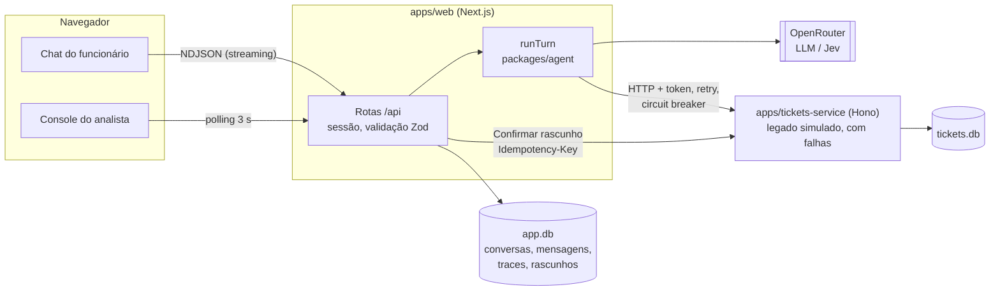

# Nexo Assist

Assistente de chat do service desk de TI da Nexo, com console para os analistas.
O funcionário tira dúvidas, consulta e abre chamados conversando; o analista recebe as
conversas que precisam de uma pessoa, já com o resumo, e vê como o assistente decidiu cada resposta.

## Como rodar

Pré-requisitos: Node 22+ e pnpm 10+.

```bash
cp .env.example .env
pnpm install
pnpm db:setup
pnpm dev
```

- App (chat e console): http://localhost:3000
- Serviço de chamados (o "legado" simulado): http://localhost:4010

No login de demonstração você escolhe o perfil (Funcionário ou Analista) e a pessoa, e entra com um
clique, sem senha. Ana Souza tem a história mais rica (chamado vencido, resolvido há 4 e há 12 dias);
Marcos e Patrícia são analistas.

**Sem chave de API** o projeto roda em `LLM_PROVIDER=mock`: um modelo roteirizado que permite
usar tudo e rodar os testes de graça. Para o modelo real, no `.env`:

```bash
LLM_PROVIDER=openrouter
LLM_API_KEY=sua-chave-da-openrouter
LLM_MODEL=anthropic/claude-haiku-5.5   # trocar de modelo é só mudar esta linha
DECISION_PROVIDER=llm                   # ou jev, para usar o modelo de decisão da TypeSafe
```

## Interface e sistema de design

- **shadcn/ui** em todos os componentes (`apps/web/src/components/ui`), sobre Radix e Tailwind v4.
- **Tokens num lugar só:** `apps/web/src/app/globals.css` define cores (OKLCH), raios e a escala tipográfica
  com nomes de uso (`text-display`, `text-title`, `text-heading`, `text-body`, `text-caption`, `text-overline`).
- **Tipografia:** Geist e Geist Mono (números de chamado e custos).
- **Marca:** logo em SVG (`components/brand/logo.tsx`): um "N" que liga dois pontos, a ideia de conexão
  entre quem pede ajuda e quem resolve. Splash de entrada uma vez por sessão.
- Console com lateral escura para a fila, métricas no topo e o painel do funcionário à direita.

## Arquitetura



| Pasta | O que é |
|---|---|
| `packages/shared` | Tipos e schemas Zod (chamado, conversa, trace) e as regras puras: prioridade, prazo em horas úteis, vencido, reabertura. |
| `packages/agent` | O assistente: entender, regras, tools, streaming e trace. Também o cliente HTTP do serviço de chamados. |
| `apps/tickets-service` | O sistema de chamados "legado", separado de propósito, com banco próprio e falhas simuladas. |
| `apps/web` | Next.js: login, chat, console, API e o banco do app. |
| `evals` | 19 cenários roteirizados do desafio, rodando com o modelo mock (CI) ou o real (`pnpm eval`). |
| `e2e` | Teste Playwright do fluxo principal. |

## Como o agent decide

Cada mensagem passa por cinco passos (`packages/agent/src/run-turn.ts`):

1. **Escopo por regra.** RH, financeiro e facilities são identificados por termos e redirecionados sem chamar o modelo (custo zero).
2. **Entender.** Uma chamada curta com saída estruturada (Zod) devolve intenção, confiança, se é crítico e o chamado citado. Pode ser o próprio LLM ou o **Jev**, um modelo que só decide e devolve probabilidades calibradas.
3. **Regras em código.** Pedido de analista, caso crítico ou confiança abaixo do limiar (0,6) transferem na hora, com um resumo montado por template.
4. **Responder com tools.** O LLM só recebe as tools da intenção detectada. As tools leem o sistema de chamados e **montam rascunhos**; nenhuma grava. A prioridade e o prazo são calculados por funções puras, não pelo modelo.
5. **Depois da resposta.** Chamado vencido gera o botão "Falar com analista"; falha do sistema de chamados gera aviso e reduz a confiança; tudo vai para o trace.

O funcionário vê as ações ("consultou seus chamados") acima da resposta e, ao expandir **Como decidi**,
o que o assistente entendeu, o que fez, a confiança, o porquê, as regras aplicadas e o custo.

**Gravar exige clique.** O único caminho que cria, complementa ou reabre chamado é o botão Confirmar,
que chama `POST /api/drafts/:id/confirm`. O servidor confere dono, status e versão do rascunho, e envia
com `Idempotency-Key: draftId:versão`, então clique duplo ou retry não duplicam o chamado.

**Privacidade.** O `requesterId` vem sempre da sessão (cookie assinado com HMAC), nunca do modelo nem do
corpo da requisição. O serviço de chamados responde 404 para chamado de outra pessoa, e o app faz o mesmo para conversas e rascunhos.

## Como garanti a qualidade das decisões

- **Regras determinísticas testadas** (prioridade, horas úteis, vencido, 7 dias, duplicidade, escopo, confiança, limite de mensagens).
- **19 cenários de avaliação** (`evals/scenarios.ts`) com o resultado esperado: intenção, tools, rascunho, prioridade, transferência, regras e o que não pode vazar. Rodam no `pnpm test` com o mock e no `pnpm eval` com o modelo real, que grava `docs/eval-report.md` com acerto, custo e latência.
- **Confirmação obrigatória** para qualquer escrita.
- **Confiança composta**: a autoavaliação do modelo é limitada por tetos em código (intenção desconhecida, tool falhou, artigo fraco), e abaixo de 0,6 vai para um analista.
- **Testes do serviço de chamados e do app** cobrindo privacidade, idempotência, falhas e persistência depois de reiniciar.
- **E2E** do fluxo principal com Playwright.

```bash
pnpm typecheck && pnpm lint && pnpm test   # 87 testes
pnpm test:e2e                              # Playwright (sobe tudo sozinho)
pnpm eval                                  # cenários com o modelo do .env
```

## Escolha da LLM

Padrão: **Claude Haiku 5.5 via OpenRouter** (US$ 0,10 por milhão de tokens de entrada e US$ 0,50 de saída).
É rápido, bom em tool calling e saída estruturada, e barato o bastante para um service desk com 2.000
pessoas. A OpenRouter permite trocar de modelo mudando uma variável, sem mudar código.

Estimativa por turno: cerca de 5 mil tokens de entrada e 300 de saída, **menos de US$ 0,001**. Uma conversa
típica de 6 turnos fica abaixo de US$ 0,01. Os números reais saem no `docs/eval-report.md` e no console.

**Jev (opcional).** Para o passo "entender", o Jev devolve probabilidades calibradas em cerca de 170 ms e
custa uma fração do LLM. Fica atrás da interface `DecisionEngine` (`DECISION_PROVIDER=jev`), para comparar
nos evals antes de adotar.

## Trade-offs

- **AI SDK direto em vez de um framework de agents.** Menos camadas e cada passo do fluxo fica visível no código. Em troca, memória e orquestração são feitas à mão (são simples aqui).
- **Busca de artigos por palavras-chave**, sem embeddings: com 8 artigos é suficiente e explicável. Com centenas, trocaria por embeddings.
- **SQLite em arquivo**, um banco por serviço: zero infraestrutura e sobrevive a reinício. Não serve para várias instâncias.
- **Polling de 3 s no console** em vez de WebSocket/SSE: simples e suficiente para a demo.
- **Vencido oferece analista em vez de transferir sozinho** (decisão D06): o funcionário pode só querer saber o status. O console destaca a conversa mesmo assim.
- **Resumo de transferência por template**, sem LLM: instantâneo e não inventa fatos.
- **Rate limit em memória** por usuário (20 mensagens por minuto): basta para um processo só.

## O que faria com mais tempo

- Rodar os evals com o modelo real em CI noturno e acompanhar acerto e custo por versão do prompt.
- Comparar LLM e Jev no passo "entender" com mais cenários rotulados.
- SSE no console e notificação ao funcionário quando o analista responder.
- Postgres e fila para o envio ao legado, com reprocessamento quando ele voltar.
- Observabilidade: trace exportado para OpenTelemetry, painel de custo e de transferências.
- Autenticação real (SSO da empresa) no lugar do login de demonstração.

## Deploy

Demo em um serviço só (`Dockerfile` + `render.yaml`): o serviço de chamados roda por dentro, na porta 4010,
e o app web na porta pública. Roda em `LLM_PROVIDER=mock`, sem custo de LLM; `AUTH_SECRET` e o token do
serviço são gerados pela plataforma. Os bancos SQLite são recriados a cada deploy com os dados de exemplo.

No Render: **New > Blueprint**, escolher este repositório e confirmar. Para usar o modelo real, definir
`LLM_PROVIDER=openrouter`, `LLM_API_KEY` e `LLM_MODEL` nas variáveis do serviço (nunca no código).

## Documentação

- [docs/DECISOES.md](docs/DECISOES.md): decisões, ambiguidades e premissas.
- [docs/ESTUDO.md](docs/ESTUDO.md): mapa do código, fluxo de uma mensagem, perguntas de entrevista e onde mexer.
- [docs/eval-report.md](docs/eval-report.md): último resultado dos evals.
